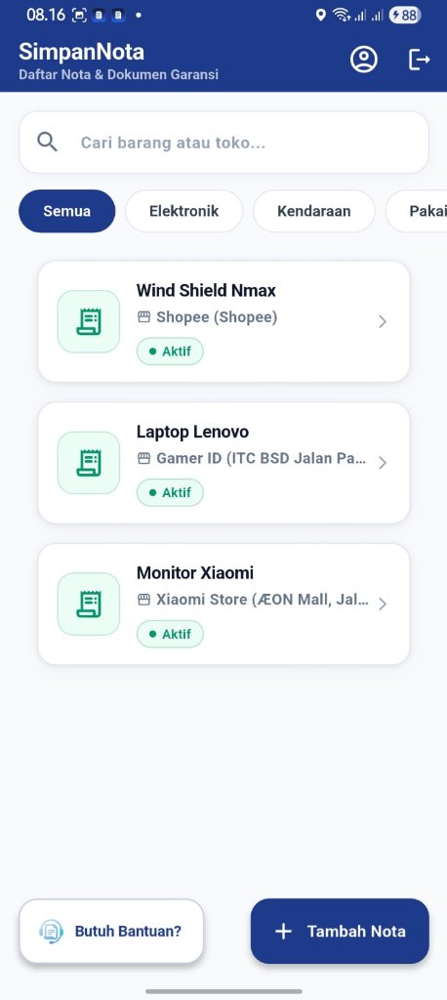
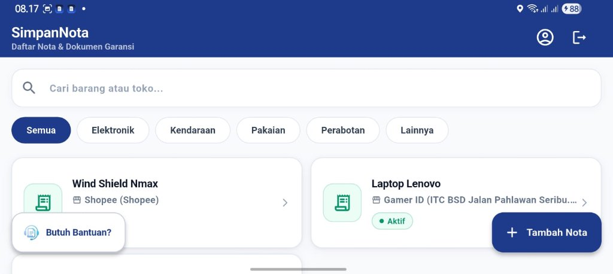
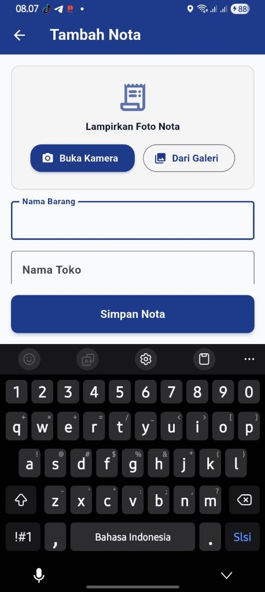
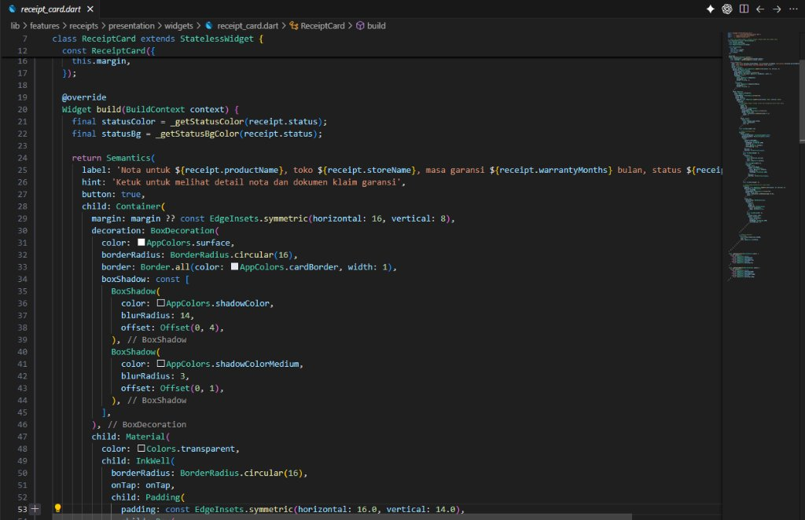
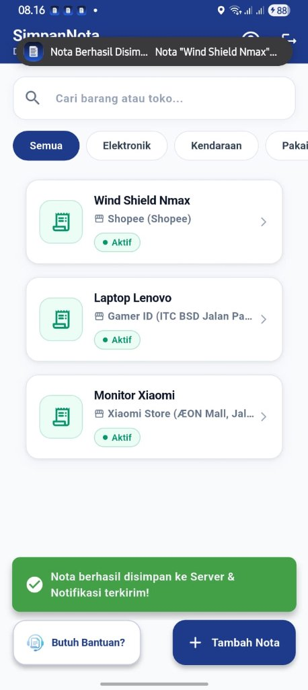

# PANDUAN PENGUJIAN APLIKASI (REVIEWER GUIDE - PRAKTIKUM 8)
## Aplikasi SimpanNota — Manajemen & Pelacak Garansi Nota Digital

Buku panduan ini disusun khusus untuk mempermudah Dosen Penguji / Reviewer dalam memverifikasi dan menguji implementasi 4 Kriteria UI/UX Lanjutan pada aplikasi **SimpanNota** saat aplikasi dijalankan (*run*).

---

## 📋 Daftar Fitur yang Diuji

| No | Kriteria UI/UX | Lokasi Kode Utama |
|---|---|---|
| 1 | **Layout Adaptif (List & Grid)** | `lib/features/receipts/presentation/screens/home_screen.dart` |
| 2 | **Keyboard-Safe UI (Bebas Overflow)** | `lib/features/receipts/presentation/screens/add_receipt_screen.dart`<br>`lib/features/auth/presentation/screens/auth_screen.dart` |
| 3 | **Aksesibilitas Dasar (Semantics)** | `lib/features/receipts/presentation/widgets/receipt_card.dart`<br>`lib/features/receipts/presentation/widgets/category_chips.dart`<br>`lib/features/receipts/presentation/screens/add_receipt_screen.dart`<br>`lib/features/auth/presentation/screens/auth_screen.dart` |
| 4 | **Feedback Aksi (Loading & SnackBar)** | `lib/features/receipts/presentation/screens/add_receipt_screen.dart`<br>`lib/features/auth/presentation/screens/auth_screen.dart`<br>`lib/features/receipts/presentation/screens/home_screen.dart` |

---

## 1. Panduan Pengujian Layout Adaptif

### A. Penjelasan Konsep
Halaman Dashboard (`HomeScreen`) menggunakan widget `LayoutBuilder` untuk mendeteksi batas lebar layar (*constraints.maxWidth*) secara dinamis:
- **Layar HP Standar (Lebar < 600 px / Portrait):** Nota ditampilkan dalam bentuk `ListView.builder` vertikal 1 kolom yang nyaman dibaca dengan satu tangan.
- **Layar Lebar / Tablet / Landscape (Lebar ≥ 600 px):** Tampilan nota otomatis beralih menjadi `GridView.builder` multi-kolom (2 kolom untuk layar tablet sedang/landscape, 3 kolom jika lebar ≥ 900 px).

### B. Langkah Pengujian saat Aplikasi Berjalan
1. Buka aplikasi hingga masuk ke **HomeScreen (Dashboard)**.
2. **Cara 1 (Rotasi Layar HP / Emulator):**
   - Tekan tombol rotasi pada emulator (*Rotate Device*) atau putar perangkat fisik ke mode **Landscape**.
   - Perhatikan daftar nota yang sebelumnya berbentuk satu kolom vertikal langsung berganti menjadi **Grid multi-kolom** yang rapi.
3. **Cara 2 (Mode Split Screen Android / Tablet):**
   - Aktifkan mode *Split Screen* pada perangkat Android. Geser garis pemisah untuk mempersempit layar (menjadi List) atau memperlebar layar (menjadi Grid).
4. **Cara 3 (Menjalankan Automated Widget Test):**
   Jalankan perintah berikut di terminal:
   ```bash
   flutter test test/advanced_ui_ux_test.dart
   ```
   *Test case membuktikan rendering GridView pada viewport 800x600 dan ListView pada viewport 400x800.*

#### Bukti Implementasi Layout Adaptif:
| Mode Portrait (ListView 1 Kolom) | Mode Landscape (GridView 2 Kolom) |
| :---: | :---: |
|  |  |
*Gambar 1: Tampilan otomatis beralih dari ListView vertikal 1 kolom (Portrait) menjadi GridView multi-kolom (Landscape).*

---

## 2. Pembuktian Keyboard-Safe UI

### A. Penjelasan Konsep
Salah satu masalah umum pada Flutter adalah munculnya peringatan *Yellow-Black Striped Error (A RenderFlex overflowed by ... pixels)* saat keyboard virtual muncul.

Pada SimpanNota:
- Semua formulir pada `AddReceiptScreen` dan `AuthScreen` (`LoginScreen` & `RegisterScreen`) dibungkus menggunakan `SingleChildScrollView`.
- Ditambahkan penyesuaian dinamis terhadap keyboard melalui parameter:
  ```dart
  padding: EdgeInsets.fromLTRB(..., MediaQuery.of(context).viewInsets.bottom + ...)
  ```
- Properti `resizeToAvoidBottomInset: true` diaktifkan pada `Scaffold`.

### B. Langkah Pengujian saat Aplikasi Berjalan
1. Buka halaman **Tambah Nota** (tekan tombol floating `+ Tambah Nota` di HomeScreen).
2. Ketuk kolom input paling bawah (misalnya kolom **Masa Garansi** atau **Pilih Tanggal Beli**).
3. Saat keyboard virtual muncul dan menutupi setengah layar:
   - **Hasil yang Diharapkan:** Form dapat di-scroll ke atas secara mulus. Tidak ada garis kuning-hitam (*overflow error*), dan tombol simpan atau kolom input tetap dapat diakses dengan mudah.
4. Lakukan hal yang sama pada form **Login** dan **Register** di `AuthScreen`.

#### Bukti Implementasi Keyboard-Safe UI:
<div align="center">
  
  <p><em>Gambar 2: Form Tambah Nota tetap rapi, dapat di-scroll secara mulus, dan bebas dari error yellow-black overflow saat keyboard virtual menutupi layar.</em></p>
</div>

---

## 3. Pengecekan Aksesibilitas (Semantics)

### A. Penjelasan Konsep & Letak Implementasi Kode
Untuk mendukung pengguna berkebutuhan khusus yang memanfaatkan pembaca layar (*screen reader* seperti Android TalkBack atau iOS VoiceOver), elemen-elemen UI penting telah dibungkus dengan widget `Semantics` yang memiliki deskripsi `label`, status, dan `hint` tindakan:

1. **Kartu Nota (`receipt_card.dart`):**
   - *Lokasi Kode:* Baris 20–24.
   - *Properti:* Membacakan nama barang, nama toko, durasi garansi, dan status garansi aktif/segera habis/kedaluwarsa.
2. **Filter Kategori (`category_chips.dart`):**
   - *Lokasi Kode:* Baris 31–37.
   - *Properti:* Menginformasikan kategori yang sedang aktif (`selected: isSelected`) dan panduan memilih.
3. **Pencarian & Tombol Dashboard (`home_screen.dart`):**
   - *Lokasi Kode:* Search field (Baris 160), Tombol Logout (Baris 144), FAB Tambah Nota (Baris 347).
4. **Form Input & Aksi (`add_receipt_screen.dart` & `auth_screen.dart`):**
   - *Lokasi Kode:* Semua input `TextField`, tombol ambil foto kamera/galeri, tombol simpan nota, input email, password, tombol login/register, dan pemindaian biometrik.

### B. Langkah Pengujian
1. **Inspeksi Kode:** Buka file-file di atas untuk memeriksa deklarasi `Semantics(label: ..., hint: ..., button: true)`.
2. **Pengujian TalkBack (Perangkat Android Fisik):**
   - Masuk ke *Settings > Accessibility > TalkBack*, lalu aktifkan.
   - Sentuh kartu nota: Sistem akan mengucapkan: *"Nota untuk [Nama Barang], toko [Nama Toko], masa garansi ... Ketuk untuk melihat detail nota..."*
3. **Automated Accessibility Test:**
   Jalankan `flutter test test/advanced_ui_ux_test.dart` — tes nomor 2 memverifikasi eksistensi widget Semantics pada `ReceiptCard`.

#### Bukti Implementasi Aksesibilitas (Semantics):
<div align="center">
  
  <p><em>Gambar 3: Implementasi widget Semantics pada ReceiptCard di receipt_card.dart lengkap dengan label deskriptif, hint tindakan, dan button: true untuk pembaca layar (TalkBack / VoiceOver).</em></p>
</div>

---

## 4. Skenario Feedback Aksi (Loading Spinner & Elegant SnackBar)

### A. Penjelasan Konsep
Aplikasi memberikan umpan balik instan (*visual feedback*) terhadap setiap interaksi pengguna agar aplikasi terasa responsif dan profesional:
1. **Button Loading Indicator:**
   - Tombol berubah menampilkan `CircularProgressIndicator` putih berputar saat state proses aktif (misal `_isSubmitting == true` atau `_isLoading == true`).
   - Tombol secara otomatis dinonaktifkan (`onPressed: null`) guna mencegah klik ganda (*double request/submission*).
2. **Floating SnackBar Elegan:**
   - Menggunakan konfigurasi `SnackBarBehavior.floating` dengan sudut melengkung (`BorderRadius.circular(10)`).
   - Memiliki ikon status indikator (centang hijau untuk operasi berhasil, silang merah untuk galat).

### B. Skenario Pengujian Praktis
1. **Skenario Simpan / Edit Nota (`AddReceiptScreen`):**
   - Isi form nota, lalu tekan tombol **Simpan Nota**.
   - **Perhatikan:** Tombol seketika menampilkan animasi berputar.
   - Setelah data tersimpan, muncul **SnackBar hijau melayang** bertuliskan *"Nota berhasil disimpan!"* dengan ikon centang.
2. **Skenario Validasi Form Kosong:**
   - Kosongkan nama barang, lalu tekan **Simpan Nota**.
   - Input field langsung menampilkan pesan error validasi warna merah tanpa crashing.
3. **Skenario Hapus Nota (`HomeScreen`):**
   - Geser (*swipe*) salah satu nota ke arah kiri untuk menghapus.
   - Muncul **SnackBar melayang** bertuliskan *"[Nama Barang] berhasil dihapus"*.
4. **Skenario Autentikasi (`LoginScreen` / `RegisterScreen`):**
   - Masukkan akun lalu tekan **Masuk**. Tombol menampilkan animasi spinner sebelum berpindah halaman dengan transisi *fade* yang halus.

#### Bukti Implementasi Feedback Aksi:
<div align="center">
  
  <p><em>Gambar 4: Tampilan Floating SnackBar hijau status berhasil dan banner notifikasi saat nota sukses tersimpan ke server.</em></p>
</div>

---

## 5. Ringkasan Eksekusi Pengujian Otomatis

Seluruh fungsionalitas di atas dapat diuji secara instan melalui suite pengujian otomatis yang telah disediakan:

```bash
# 1. Analisis statis kode (Harus 0 issues)
flutter analyze

# 2. Menjalankan seluruh pengujian (19 test cases)
flutter test
```

### Output Pengujian:
```text
Analyzing SimpanNota...
No issues found!

00:03 +19: All tests passed!
```

---

## 6. Fitur Baru Unggulan (Pembaruan Terkini)

### A. Pilihan Waktu Garansi Fleksibel (Bulan / Hari / Bulan + Hari)
- **Lokasi Kode:** `lib/features/receipts/presentation/screens/add_receipt_screen.dart`, `lib/features/receipts/domain/receipt.dart`
- **Fitur:** Pengguna dapat memilih format masa berlaku garansi dalam 3 pilihan melalui chip selector:
  1. **Bulan Saja:** contoh `12 Bulan`.
  2. **Hari Saja:** contoh `15 Hari`.
  3. **Bulan + Hari:** contoh `1 Bulan 15 Hari`.
- **Live Preview:** Terdapat kartu kalkulasi otomatis yang menampilkan estimasi durasi dan tanggal jatuh tempo kedaluwarsa secara *real-time* saat pengguna mengisi angka.
- **Penyimpanan:** Kolom `warrantyMonths` dan `warrantyDays` terintegrasi pada SQLite lokal serta fallback sinkronisasi Supabase Cloud.

### B. Jadwal Pengingat Notifikasi Garansi (Scheduled Notification)
- **Lokasi Kode:** `lib/core/services/notification_service.dart`, `lib/features/receipts/presentation/controllers/add_receipt_notifier.dart`, `android/app/src/main/AndroidManifest.xml`
- **Fitur:** Menggunakan `flutter_local_notifications` dan `timezone` dengan mode `zonedSchedule`:
  - Sistem secara otomatis menghitung H-7 sebelum masa garansi nota habis dan menjadwalkan alarm notifikasi pukul 09:00 pagi.
  - Untuk produk dengan garansi singkat (< 7 hari), sistem otomatis menyesuaikan pengingat ke H-1 pukul 09:00 pagi.
  - Saat nota dihapus oleh pengguna, sistem secara otomatis membatalkan (*cancel*) jadwal notifikasi pengingat tersebut agar tidak terjadi notifikasi hantu (*phantom notifications*).

### C. Mode Gelap (Dark Mode) & Pengaturan Tema
- **Lokasi Kode:** `lib/core/theme/theme_provider.dart`, `lib/main.dart`, `lib/features/profile/presentation/screens/profile_screen.dart`
- **Fitur:** 
  - Dukungan tema gelap modern dengan palet warna Slate Navy (`#0F172A`), Slate Surface (`#1E293B`), dan Card Border (`#334155`).
  - Pengguna dapat beralih antara Mode Terang dan Mode Gelap melalui Switch adaptif pada halaman **Profil Saya** (`ProfileScreen`).
  - Seluruh komponen (Dashboard, Kartu Nota, Detail Nota, Profil) beradaptasi secara elegan terhadap tema yang aktif.

### D. Filter Urutan Nota (Sorting Dashboard)
- **Lokasi Kode:** `lib/features/receipts/presentation/controllers/receipt_list_notifier.dart`, `lib/features/receipts/presentation/screens/home_screen.dart`
- **Fitur:**
  - Tombol pengurutan responsif di samping bilah pencarian *Dashboard* dengan ikon filter slider modern (`Icons.tune_rounded`).
  - Menawarkan 4 kriteria pengurutan nota secara instan dengan ikon representatif masing-masing:
    1. **Garansi Segera Habis:** Mengutamakan nota dengan tanggal jatuh tempo terdekat di bagian atas agar pengguna tidak kecolongan klaim garansi.
    2. **Tanggal Beli (Terbaru):** Urutan kronologis pembelian barang terkini (default).
    3. **Tanggal Beli (Terlama):** Mengurutkan dari barang yang paling lama dibeli.
    4. **Nama Barang (A - Z):** Mengurutkan secara alfabetis berdasarkan nama barang belanjaan.

### E. Multi-Lampiran (Foto Struk Nota + Foto Kartu Garansi Fisik)
- **Lokasi Kode:** `lib/features/receipts/domain/receipt.dart`, `lib/features/receipts/presentation/screens/add_receipt_screen.dart`, `lib/features/receipts/presentation/screens/receipt_detail_screen.dart`, `lib/core/local/database_helper.dart`
- **Fitur:**
  - Pengguna dapat melampirkan hingga 2 dokumen foto:
    1. **Foto Struk / Nota Kasir (Wajib):** Bukti sah transaksi pembayaran.
    2. **Foto Kartu Garansi Fisik (Opsional):** Bukti nomor seri IMEI, barcode pabrikan, atau kartu garansi bertanda cap toko.
  - **Pratinjau Multi-Lampiran di Halaman Detail:**
    - Tampilan *Detail Nota* secara cerdas menyediakan tab toggle melayang (*pill switch*): **[Foto Nota]** dan **[Kartu Garansi]**.
    - Didukung fitur pembesaran gambar (*Pinch-to-Zoom / InteractiveViewer*).
    - Tombol download dapat menyimpan gambar nota maupun kartu garansi yang sedang aktif ke galeri penyimpanan HP secara terpisah.
  - **Sinkronisasi Data:** Tersimpan pada database lokal SQLite (`warrantyCardPath`) dan Supabase Cloud Storage (`warranty_card_path`).

---
*Dokumen ini dibuat secara resmi untuk dokumentasi Praktikum 8 mata kuliah Pemrograman Perangkat Bergerak / Mobile App Development.*

